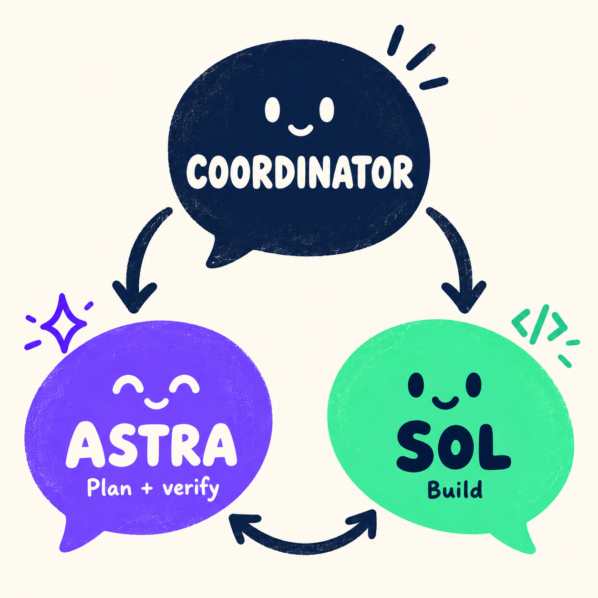

# Codex coordinator

A reusable planning, implementation, and verification workflow, with a Sierpiński triangle example.

## Run the v2 process



Open this repository as a Codex project with a local checkout. In a coordinator chat, send:

```text
@sierpinski-triangle_v2_goal.md.
```

The process runs in sequence: Astra writes `howto.md`, Sol implements the
graphical application and writes `result.md`, then Astra writes
`verification.md`. The coordinator reviews each stage and routes corrections
until acceptance passes or a blocker needs user input.

Use a Codex environment with separate-chat tools and both requested models
available. See [the v2 goal](sierpinski-triangle_v2_goal.md) for acceptance
criteria and [the coordinated method](coordinated_method.md) for the full process.

### Permissions in `.codex/config.toml`

The v2 coordinator creates worker chats and sends them follow-up messages.
The project-local [`.codex/config.toml`](.codex/config.toml) lets these Codex app
MCP calls run without an approval dialog each time. Its key settings are:

```toml
[plugins."codex-app-tools@openai-bundled".mcp_servers.codex_app]
default_tools_approval_mode = "approve"

[plugins."codex-app-tools@openai-bundled".mcp_servers.codex_app.tools.create_thread]
approval_mode = "approve"

[plugins."codex-app-tools@openai-bundled".mcp_servers.codex_app.tools.send_message_to_thread]
approval_mode = "approve"
```

`default_tools_approval_mode` sets the server-wide default. The explicit
per-tool entries override the plugin's bundled prompts for chat creation and
messaging; setting only the default would leave those prompts in place.
`"approve"` allows a call automatically; `"prompt"` asks for confirmation.
The full config also explicitly approves automation updates, forks, handoffs,
and moving chats between projects.

These settings apply to this trusted project and the Codex app MCP plugin.
They do not grant filesystem access or browser site access. Trust the project
when opening it, and restart the app if changes are not picked up. Browser
approvals are managed separately in Settings → Browser → Agent permissions.

## Run the v1 process

Open this repository as a Codex project with a local checkout. In one
coordinator chat, send:

```text
@sierpinski-triangle_v1_goal.md.
```

Follow the process from that same coordinator chat. It creates an Astra planning
chat to write `howto.md`, then a Sol implementation chat to build the terminal
application and write `result.md`. The coordinator reviews the plan and result,
checks the evidence, and routes any corrections to Sol.

All deliverables go into `sierpinski-triangle_v1/`. Use a Codex environment with
separate-chat tools and both requested models available. See [the v1 goal](sierpinski-triangle_v1_goal.md)
for acceptance criteria and [the one-session method](onesession_method.md) for
the full process.

Both goal files live in the repository root alongside the reusable methods.
Each run creates its corresponding `sierpinski-triangle_v1/` or
`sierpinski-triangle_v2/` directory for generated products, reports, and working
files. Those directories are disposable; preserve the root goal files, methods,
and this README when cleaning up a run.
